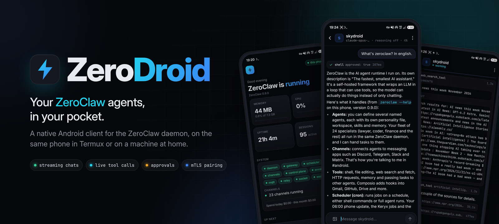

<div align="center">

# ZeroDroid

Your [ZeroClaw](https://github.com/zeroclaw-labs/zeroclaw) agents, in your pocket.

[](https://github.com/SyscallBrain/zerodroid/actions/workflows/ci.yml)
[](https://github.com/SyscallBrain/zerodroid/releases/latest)
[](LICENSE)
[](#install)
[](https://kotlinlang.org)
[](https://developer.android.com/compose)
[](https://github.com/zeroclaw-labs/zeroclaw)

[Install](#install) ·
[Pairing](#pairing) ·
[Screenshots](#screenshots) ·
[Changelog](CHANGELOG.md) ·
[Report a bug](https://github.com/SyscallBrain/zerodroid/issues/new?template=bug_report.yml)

</div>

<p align="center">
  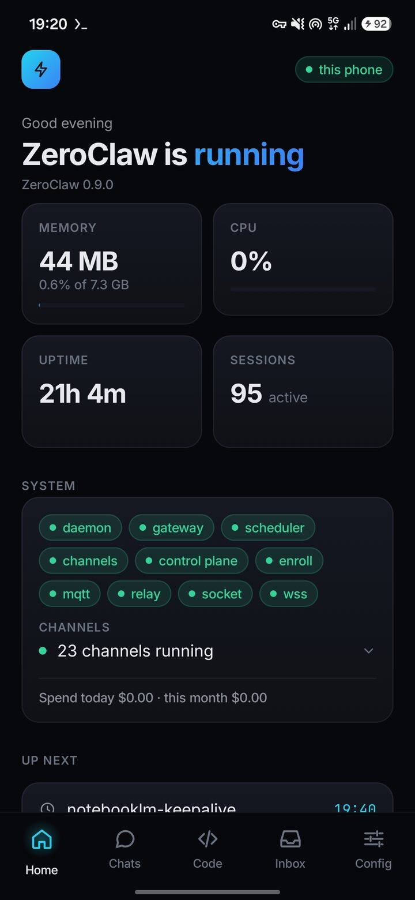
  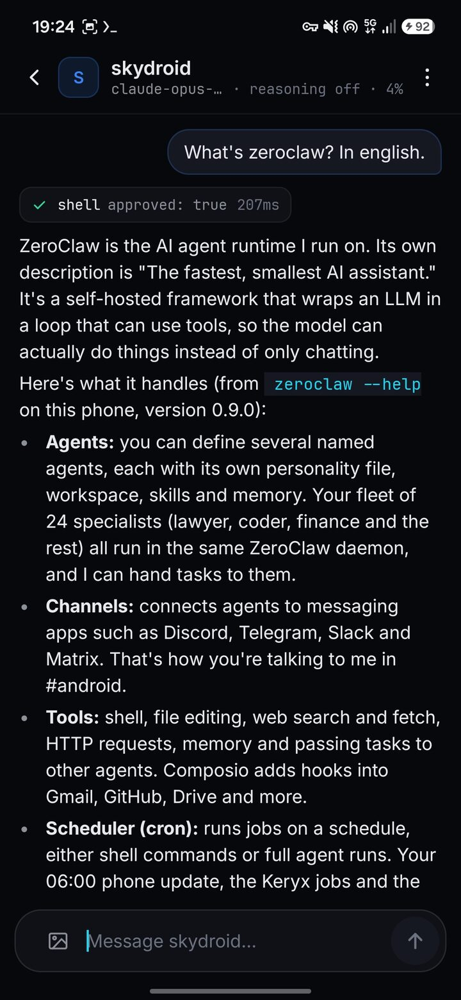
  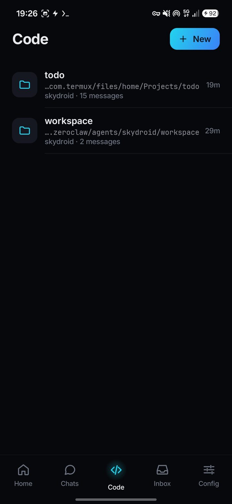
  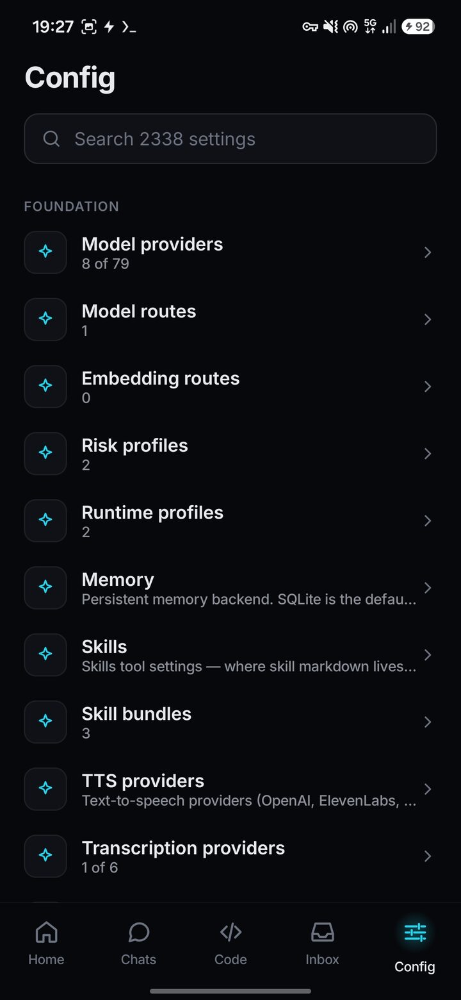
</p>

ZeroDroid is a native Android client for the [ZeroClaw](https://github.com/zeroclaw-labs/zeroclaw)
daemon. Talk to any of your agents, follow their tool calls as they run,
answer approvals from a notification, and check or change the daemon's
configuration, whether the daemon runs in Termux on the same phone or on a
machine at home.

It is a remote control, not a second runtime: agents, tools, channels and
memory all stay on the daemon.

## Features

- **Home**: the daemon at a glance. Memory, CPU, uptime and active sessions,
  which subsystems and channels are running, today's spend, the next
  scheduled jobs, and your agents with pinned favourites at the top.
- **Chats** with any agent, across many sessions. Answers stream in with
  Markdown and code formatting, every tool call shows its arguments and
  output, and you can steer or stop a running turn. Send images, rename and
  delete chats, search them, and see or change the model in use.
- **Code**: sessions rooted in a folder on the daemon's machine, like
  zerocode. Pick the folder with a browser, or work in the agent's workspace.
- **Approvals**: when an agent asks for permission, approve or deny from the
  Inbox or straight from the notification. Nothing is ever approved without
  your tap.
- **Runs in the background**: a running turn keeps its connection through a
  foreground service, so it is not cancelled when you switch apps.
- **Config**: every daemon setting, grouped and searchable, edited with the
  right control for each type (switches, lists, choices, numbers).
- **Secure pairing**: mutual TLS 1.3 with a client key that never leaves the
  Android Keystore, a pinned CA, and an encrypted bearer token. Pairing
  always asks you to compare a short code, so another app cannot pair
  silently.

## Screenshots

| | | |
|:-:|:-:|:-:|
|  | 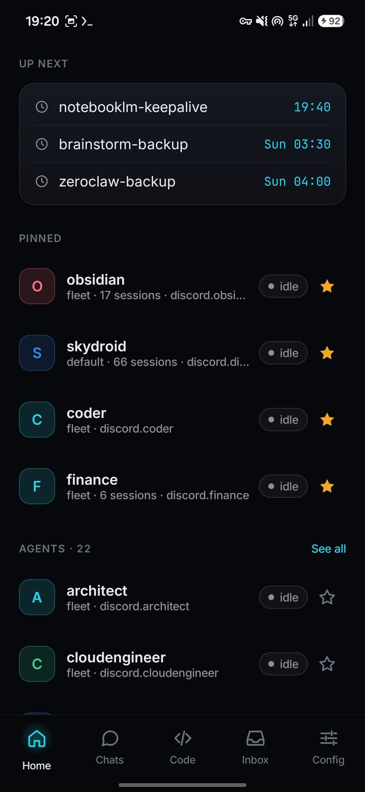 | 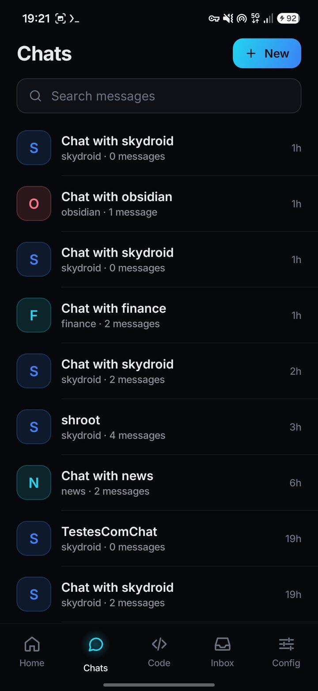 |
| Home | Up next and pinned agents | Chats |
| 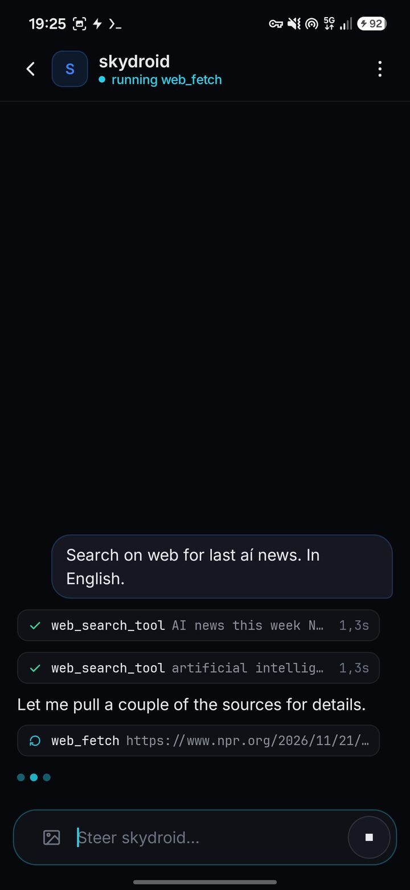 | 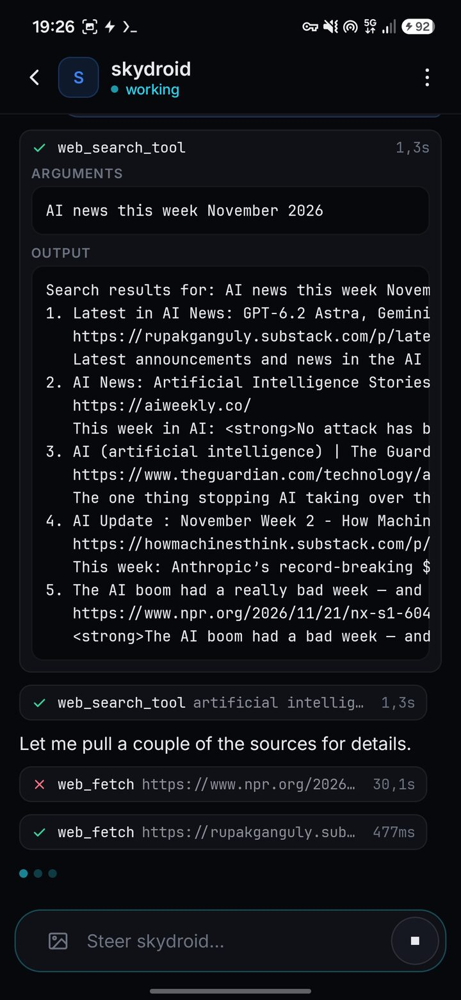 | 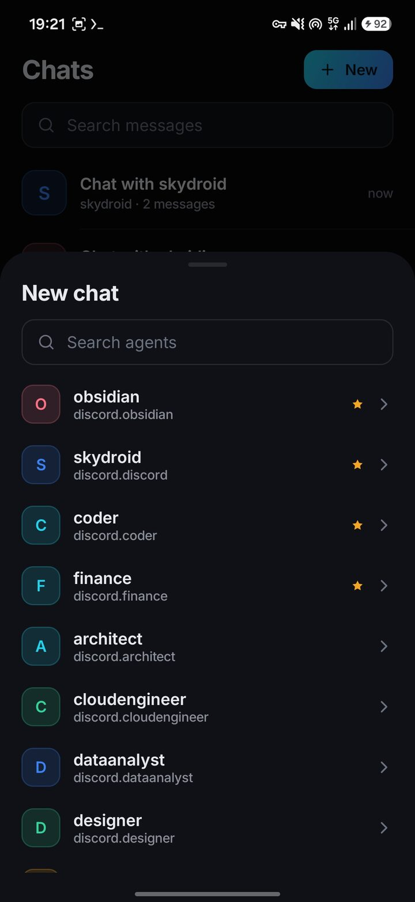 |
| A turn running | Tool call details | New chat |
| 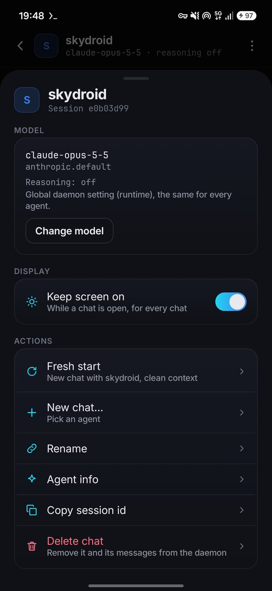 | 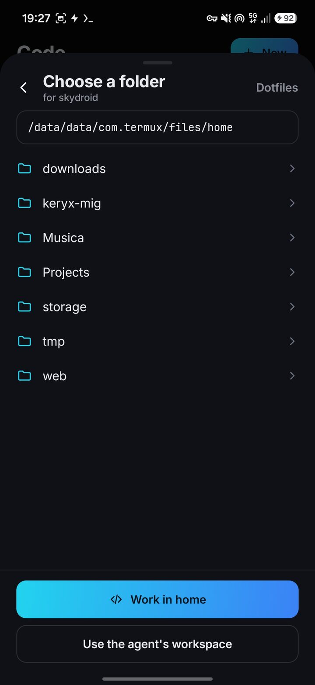 | 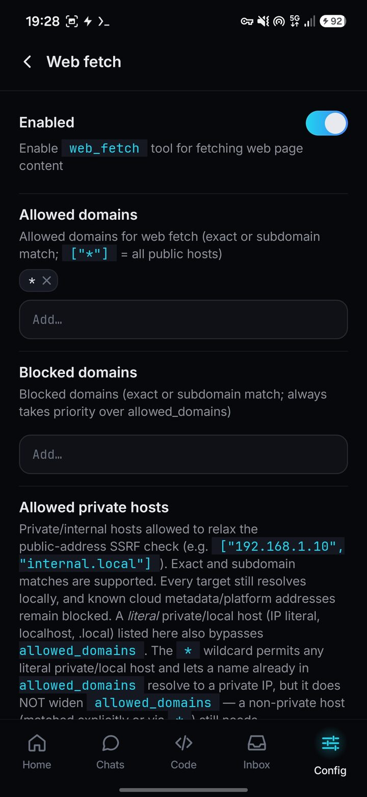 |
| Chat menu | Choose a folder | Editing a setting |

<details>
<summary>Pairing</summary>

| | | |
|:-:|:-:|:-:|
| 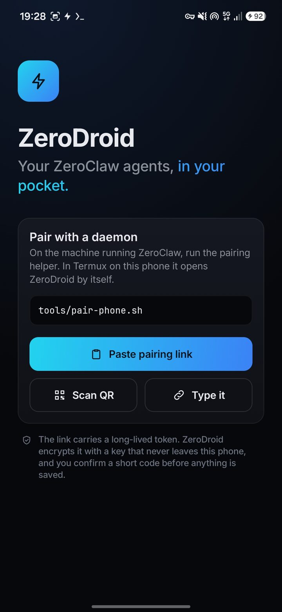 | 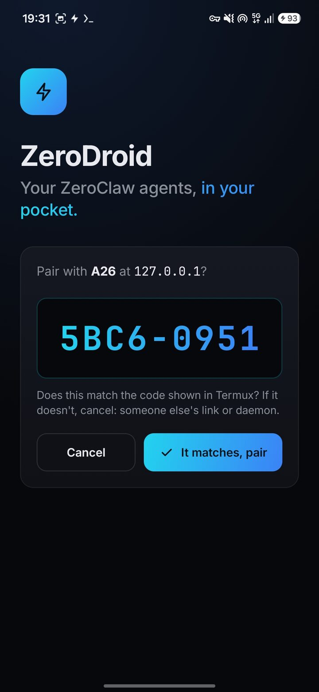 | 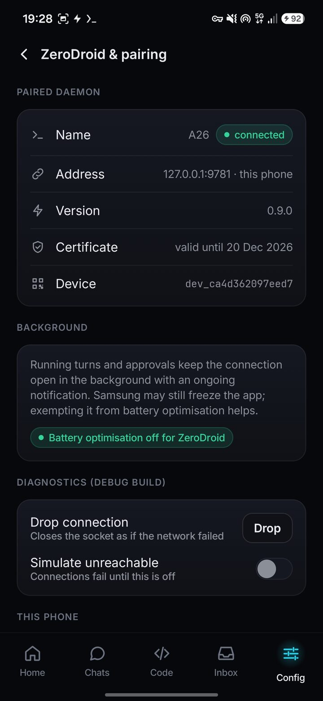 |
| Welcome | Compare the code | Paired daemon |

</details>

## Install

You need Android 10 or newer and a ZeroClaw daemon, version 0.9.0 or newer,
with its RPC plane (WSS) and enrollment endpoint enabled.

Download `zerodroid-X.Y.Z.apk` from the
[latest release](https://github.com/SyscallBrain/zerodroid/releases/latest)
and open it on the phone. Android asks you to allow installs from your
browser or file manager the first time. `SHA256SUMS` lists the checksum of
the APK, and every release carries signed build provenance:

```sh
sha256sum -c SHA256SUMS
gh attestation verify zerodroid-X.Y.Z.apk --repo SyscallBrain/zerodroid
```

To build it yourself, see [CONTRIBUTING.md](CONTRIBUTING.md).

### Keeping your sessions: the ZeroClaw patch

Everything in ZeroDroid works with an unmodified ZeroClaw 0.9.0, with one
catch: **after the daemon restarts, the chats and code sessions you started
from the phone disappear from the app.**

The daemon gives a remote client only the sessions it owns, and it keeps
that ownership in memory. When the daemon restarts, the ownership is lost:
your sessions are still in the daemon's store, but the daemon no longer
lists them for ZeroDroid and refuses to reopen them.

The fix is a small patch to ZeroClaw. It records which remote client created
each chat session and lets that same client list and resume it while no one
else has it open. The patch is not part of an official ZeroClaw release yet.
It lives in the
[`zerodroid/remote-durable-session-owner`](https://github.com/SyscallBrain/zeroclaw/tree/zerodroid/remote-durable-session-owner)
branch on my fork, as a single commit on top of ZeroClaw 0.9.0.

If you run the daemon in Termux on an Android phone, build
[`android-v0.9.0-zerodroid`](https://github.com/SyscallBrain/zeroclaw/tree/android-v0.9.0-zerodroid)
instead. It adds a fix for the shell tool, which fails in Termux because
Android's SELinux blocks resolving `/system/bin/sh`.

Build the daemon from either branch as you would build ZeroClaw. The patch only
adds a column to the session store, so you can go back to an official release
at any time.

## Pairing

The phone needs two things from the daemon: a client certificate from the
enrollment endpoint and a bearer token from the gateway.
[`tools/pair-phone.sh`](tools/pair-phone.sh) gets both on the machine that
runs ZeroClaw and hands them to the app in a single `zerodroid://pair` link.

**Daemon in Termux on the same phone.** Run the script in Termux; it opens
ZeroDroid with everything filled in:

```sh
tools/pair-phone.sh
```

**Daemon on another machine.** Print the link and get it to the phone, then
use *Paste pairing link* or *Type it* in the app. Set `ZERODROID_HOST` to an
address the phone can reach, such as the machine's Tailscale IP or MagicDNS
name (it must also be in the daemon's `[wss].sans`):

```sh
ZERODROID_HOST=my-server.tailnet.ts.net tools/pair-phone.sh --mode print
```

The app then shows a short code. Pair only if it matches the one the script
printed. The link carries a long-lived token: do not screenshot or share it.

`tools/pair-phone.sh --help` lists the options (ports, data directory,
device name).

## How it works

ZeroDroid speaks the daemon's JSON-RPC protocol over WebSocket with TLS 1.3
and a client certificate (port 9781 by default). On first use it creates a
P-256 key inside the Android Keystore, enrolls a certificate with the
one-time code (port 9782), pins the daemon's CA and stores the token
encrypted with a Keystore key.

A turn on the daemon belongs to the connection that started it, so the app
keeps that connection alive in a foreground service while a turn or an
approval is pending. Samsung and some other vendors freeze background apps
anyway; turning off battery optimisation for ZeroDroid (Config → ZeroDroid &
pairing) helps.

## Contributing

Bug reports, ideas and pull requests are welcome. Read
[CONTRIBUTING.md](CONTRIBUTING.md) for how to build and test, and
[SECURITY.md](SECURITY.md) to report a vulnerability privately.

ZeroDroid is an independent project and is not affiliated with ZeroClaw Labs.

## License

[MIT](LICENSE) © 2026 Tiago Correia. The bundled Inter and JetBrains Mono
fonts are under the SIL Open Font License ([docs/licenses](docs/licenses)).
